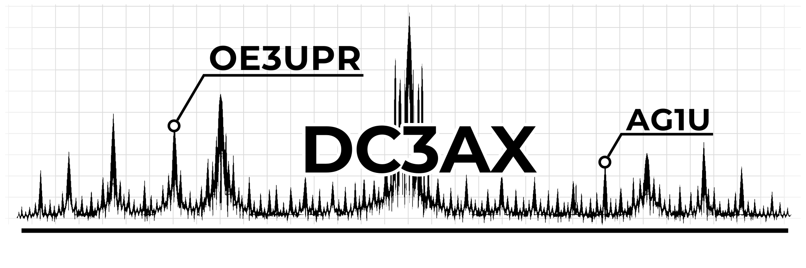

<div class="cover">
<div class="rule-top"></div>
<div class="rule-left"></div>

<div class="block">
<div class="kind">Technical Description</div>
<div class="title">4015 Memory Card</div>
<div class="subtitle">The SRAM cards of the STABILOCK 4015:<br>hardware, format, reading and writing</div>
<div class="copy">© 2026 Ulrich Prinz, OE3UPR / DC3AX / AG1U</div>
<div class="rights">Text and drawings are licensed under Creative Commons Attribution 4.0 (CC BY 4.0), the software under the MIT licence. You may copy, change and pass them on if you name the author. The card software described here is © Schlumberger / Wavetek.</div>
<div class="author"><b>Ulrich Prinz</b><br>OE3UPR / DC3AX / AG1U<br>[Contact to be added]</div>
</div>
<div class="version">Document Version: 0.1 draft, November 2026</div>
</div>

<div class="front">
<h1 class="front">Remarks</h1>
<div class="remark"><div class="sign">!</div><p>This description and the tools that come with it are not a product of the maker of the STABILOCK 4015. They were written by a radio amateur from the analysis of the instrument's firmware and of original cards, and are given to other owners as they are, without any warranty. Use them at your own risk.</p></div>
<div class="remark"><div class="sign">R</div><p>Reading a card does not change it. Writing a card replaces everything on it, including the battery-backed settings it holds. Read and keep every card before you write to it, and try a new image on a spare card first.</p></div>
<div class="remark"><div class="sign">®</div><p>STABILOCK is a registered trademark of its owner. Trade names are used in this description without special identification; they may be the property of companies or institutes.</p></div>
<div class="remark"><div class="sign">✎</div><p>Corrections, card images that are not listed here, and reports from other instruments are welcome; see the contact on the title page.</p></div>
</div>

<div class="front">
<h1 class="front">Contents</h1>
<!-- TOC -->
</div>

# For the Reader in a Hurry

## What this is about

The STABILOCK 4015 radio test set takes its option programs (tracking generator, pager and trunking tests, cellular tests) and the user's set-ups and Autorun programs from a small battery-backed memory card. The cards are 30 to 40 years old, their batteries are ageing, and the programs exist nowhere else. This description tells how such a card is built, how its content is laid out, and how it can be read, checked, kept and written again outside the instrument.

## What you need

- A device programmer that reads battery-backed static RAM (DS1230, DS1245 types), for example a TL866 or T48 from XGecu, and its software.
- An adapter from the 34-contact card to a 32-pin DIP plug (chapter 4; a build sheet comes with this description).
- Python 3 for the check tool `cardcheck.py`. It runs on Linux, Windows and macOS.

## Quick start

1. Build the adapter (chapter 4) and check it for continuity.
2. Read the card as a 128 KB `DS1245Y` part with jumper J1 open, or as a 32 KB `DS1230Y` part with J1 on Vcc, in your programmer's software. Read it twice and compare the files.
3. Run `python3 cardcheck.py MYCARD.BIN --out MYCARD_CLEAN.BIN`. It cuts the file to the card's size, checks every program record and tells you whether the card is a known one.
4. Keep both files. A card that reads `GOOD` can be written back to a spare card at any time.

# The Card

## What it is

The card is a static RAM in a flat case with one row of 34 contacts, kept alive by a 3 V lithium cell. It is a Panasonic card of the BN-…MC series (the 32 KB type is the BN-032MC), a forerunner of the 68-contact PCMCIA cards. It works from 5 V with TTL levels. Electrically a 32 KB card is one 62256 static RAM: the contact order is that of a 62256 with its two pin rows interleaved.

The family grew to 2 MB. The 4015 uses 32, 64, 128 and 256 KB cards; larger cards fit the slot but cannot be addressed by it.

## Sizes and labels

Wavetek printed the card itself with "Wavetek Memory Card", its size and a part number for the blank card, and put a sticker with the program's own part number on program cards.

| Part number | What |
|---|---|
| 897 050 | Wavetek Memory Card 32 kB (blank card) |
| 897 051 | Wavetek Memory Card 64 KB (blank card) |
| 897 933 | program TRACKING 2.00 |
| 897 972 | program EAMPS 1.00 |
| 897 981 | program POCSAG NRZ 1.00 |

The sticker gives the program name as the instrument lists it, for example "TRACKING 2.00/SYS". Some cards carry no number at all.

## The battery and the write-protect switch

The cell keeps the content. When it fails, the card is empty: an empty card reads as noise, as all `00` or all `FF`, or with a damaged directory. Before the cell is changed, read the card and check the file: the content may be lost during the change.

The write-protect switch on the card stops all writes. A program card should stay writable in use, because the instrument saves the program's last settings on it (chapter 7).

# The Slot in the Instrument

## Connector

Contact 1 is the supply, contact 34 ground. Find contact 1 on a card with a continuity tester: contacts 33 and 34 are joined to each other and to the negative pole of the cell, contact 1 is not.

| Contact | Signal | Contact | Signal |
|---|---|---|---|
| 1 | Vcc (switched) | 18 | A10 |
| 2 | A14 | 19 | A1 |
| 3 | A12 | 20 | /CS |
| 4 | /WE | 21 | A17 |
| 5 | A7 | 22 | A15 |
| 6 | A13 | 23 | A16 |
| 7 | not connected | 24 | A0 |
| 8 | not connected | 25 | D7 |
| 9 | A6 | 26 | D0 |
| 10 | A8 | 27 | D6 |
| 11 | A5 | 28 | D1 |
| 12 | A9 | 29 | D5 |
| 13 | A4 | 30 | D2 |
| 14 | A11 | 31 | D4 |
| 15 | A3 | 32 | D3 |
| 16 | /OE | 33 | card detect (ground on the card) |
| 17 | A2 | 34 | GND |

Contacts 21 to 23 carry A17, A15 and A16 and are used only by cards larger than 32 KB. Contacts 7 and 8 are not connected in the 4015; on cards above 256 KB they presumably carry further address lines, which have not been identified. The assignment comes from the instrument's schematic and agrees with an independent pin table for the BN-032MC.

## The 256 KB limit

The slot brings out A0 to A17, and the firmware sizes a card by testing 32 places 8 KB apart. Both stop at 256 KB. A 512 KB card is not addressed correctly by the 4015, although it works in other instruments with the same card format.

# Reading and Writing a Card Outside the Instrument

## The adapter

The adapter connects the card socket to a 32-pin DIP plug in the pin order of the 32-pin battery-backed RAMs (DS1245 for 128 KB, DS1250 for 512 KB). A 28-pin part sits in pins 3 to 30 of that outline, so the same adapter serves 32 KB cards as a 28-pin part and larger cards as a 32-pin part.

```
  card             DIP-32 plug             card
 contact  signal     (top view)     signal  contact
                    ┌────╮╭────┐
      –   (A18)   1 ┤          ├ 32  Vcc    1
     23   A16     2 ┤          ├ 31  A15    22
      2   A14     3 ┤          ├ 30  J1     see below
      3   A12     4 ┤          ├ 29  /WE    4
      5   A7      5 ┤          ├ 28  A13    6
      9   A6      6 ┤          ├ 27  A8     10
     11   A5      7 ┤          ├ 26  A9     12
     13   A4      8 ┤          ├ 25  A11    14
     15   A3      9 ┤          ├ 24  /OE    16
     17   A2     10 ┤          ├ 23  A10    18
     19   A1     11 ┤          ├ 22  /CS    20
     24   A0     12 ┤          ├ 21  D7     25
     26   D0     13 ┤          ├ 20  D6     27
     28   D1     14 ┤          ├ 19  D5     29
     30   D2     15 ┤          ├ 18  D4     31
  33+34   GND    16 ┤          ├ 17  D3     32
                    └──────────┘
```

**Jumper J1 at pin 30.** Pin 30 is the supply of a 28-pin part, not connected on a 128 KB part and A17 on a 512 KB part:

| J1 | Device type | Cards |
|---|---|---|
| to card contact 1 (Vcc) | DS1230Y (32 KB) | 32 KB, read and write |
| open | DS1245Y (128 KB) | 64 and 128 KB; a 32 KB card reads as well, four times over |
| to card contact 21 (A17) | DS1250Y (512 KB) | 256 KB; not tried yet |

Never leave J1 on Vcc with a 32-pin device type selected: the programmer may drive pin 30 as a signal against the supply.

The build sheet `4015_SRAM_Card_adapter.pdf` lists the same wiring sorted by card contact and by DIP pin. Keep the wires short, check each for continuity and for shorts to its neighbours, and never put the adapter into the programmer turned round: that puts 5 V on the ground side of a card with a cell in it.

## Device types

Select a battery-backed RAM with plain read and write cycles:

- **DS1230Y or DS1230AB** for a 32 KB card (J1 on Vcc).
- **DS1245Y or DS1245AB** for 64 and 128 KB cards (J1 open).
- As a fall-back for 32 KB: an **AT28C256** EEPROM, with software data protection switched off, because the unlock sequence would otherwise be written into the card as data.
- **Never a 27C256** (its pins 1 and 27 are Vpp and A14), and **never a RAM test entry** such as "DS1230Y (TEST)": a test writes patterns over the whole card.

## Reading

1. Read a spare card twice; the two files must be identical. This shows that the wiring is stable.
2. Check the file with `cardcheck.py`. Two identical reads only show that the wiring is stable, not that it is right; the check finds a missing address line, a missing upper half and damaged records.
3. Then read the cards you want to keep.

A read with a larger device type than the card holds the card several times: a 32 KB card read as 128 KB appears four times. `cardcheck.py` checks that and cuts the file to the card's size. A 64 KB card read as a 32 KB part gives only its lower half, whatever is on the upper one.

What a bad read looks like:

| Symptom | Cause |
|---|---|
| all bytes `FF` or all `00` | no contact, no chip select, or no supply: not an empty card |
| two reads differ | loose or too long wires |
| every byte appears twice | address line A0 does not reach the card |
| bytes equal at addresses that differ in one bit | that address line does not reach the card |
| a 64 KB card read as 128 KB does not repeat | A15 or A16 not wired, or floating |

## Writing

Write only after the card's content has been read and kept. Write to a spare card first, read it back, compare, and then try it in the instrument. The card's write-protect switch must be off; a card that reads back unchanged after a write points to that switch.

## With the TL866 and minipro under Linux

`cardprog.py` wraps the open-source `minipro` program for the XGecu programmers. `read OUT.BIN --large` reads twice as a DS1245Y, compares, cuts to the card's size and lists the card. `write IMAGE.BIN` reads the card first, saves its content to `backups/` unless it is a known image, writes, reads back and compares. With another programmer or operating system, use the programmer's own software and check the file with `cardcheck.py`.

# The Card Format

## Sectors

The card is divided into sectors of 512 bytes, numbered from 1. Sector *n* starts at byte (*n* − 1) × 512.

| Sector | Content |
|---|---|
| 1 | directory sector 1: card header and a label |
| 2 | directory sector 2: card header and file entries |
| 3 onward | files; on a user card the set-up slots |

## Directory sectors

Each directory sector holds 32 entries of 16 bytes. Entry 0 is a header:

| Bytes | Content |
|---|---|
| 0 | `00` |
| 1 | card size code in sector 2 (number of 8 KB blocks: `04` = 32 KB, `08` = 64 KB, `10` = 128 KB, `20` = 256 KB) |
| 2 | `02` |
| 3 | card kind: `P` program card, `U` user card, `D` (accepted by the instrument, not seen) |
| 4–11 | sector 1: the format signature `<4015.A>`; sector 2: a title or blanks |
| 12–13 | sector 1: next directory sector; sector 2: first data sector |

A file entry:

| Bytes | Content |
|---|---|
| 0 | file type |
| 1 | flags; bit 1 = file write-protected |
| 2–11 | name, 10 characters, padded with blanks |
| 12–13 | first sector |
| 14–15 | number of sectors (on program cards a nominal 25) |

In sector 1 the names of the unused entries spell out a label, for example `*SI 4015 *` and `* MEMORY *`.

## File types

| Type | Shown as | Content |
|---|---|---|
| `P` | `.SYS` | program (chapter 6) |
| `V` | – | version text of the program, shown as "Ver.:" |
| `S` | `.SET` | set-up, 1 KB (two sectors) |
| `A` | `.AUT` | Autorun program, up to 16 KB |
| `B`, `b` | `.PIC` | screen picture |
| `R` | `.RES` | results: text written by Autorun `PRINT` |
| blank | – | free entry |

The card stores no name ending; the instrument derives it from the type. A freshly formatted card is a user card with 10 set-up slots on 32 KB, 12 on 64 KB and 13 on 128 or 256 KB.

## The two sectors in front of a program

The two sectors before a program file belong to the program. The instrument writes into them while the program is in use: the first holds the program's own variables, the second instrument settings kept with the program. So two cards with the same program differ in these sectors after use, and a write-protected program card does not keep its settings. Some programs use further sectors in front of the file for stored parameter sets.

# Program Files

## Records

A program file is a chain of records. Each record starts on a sector boundary with a 16-character ASCII header, followed by the data; the next record starts at the next sector boundary.

| Header bytes | Content |
|---|---|
| 0 | record type |
| 1–5 | start address, 5 hex digits |
| 6–10 | end address, inclusive, 5 hex digits |
| 11–14 | sum of all data bytes, 16 bits, 4 hex digits |
| 15 | `0` |

| Type | Meaning |
|---|---|
| `H` | code for the Computer board (68000), loaded to RAM at `0x200000` + start; its first instruction is called once it has loaded |
| `@` | as `H`, loaded but not called (from the firmware; not tried on an instrument) |
| `1`–`7` | code for another module, sent over the internal link; `4` and `5` are the two processors of the Data Module |
| `F` | end of the file: the instrument stops loading here |

The instrument checks every sum and refuses a record that does not match. Everything behind the first `F` record is ignored; some cards carry old records there from the master they were copied from.

## The program in RAM

The Computer board's code is loaded to `0x208200` and begins with a table of jumps that the instrument calls: initialisation, the main loop service of the program's own screen, the start screen, the menu, and whether the program is an operating mode of its own. Before the table runs, the program declares what it needs: which modules must have received their code, and which options must be fitted (for example the Duplex stage for TRACKING). A program that needs the Data Module cannot run without it.

A program larger than the space at `0x208200` can come in two `H` records: the first moves its texts and tables to another part of RAM and declares the requirements, the second replaces it with the code. POCSAG TRC and EDACS are built that way; POCSAG TRC needs a 64 KB card for it.

# How the Instrument Uses a Card

## Loading and starting a program

- **RECALL** of a `.SYS` file loads the program. It does not change the screen.
- **SYSTEM** with a card inserted loads the first program on the card if it is not loaded yet; if that program is an operating mode of its own, it starts.
- If the program is already loaded, **SYSTEM** leads to the active built-in system. **MENU** there lets you choose what SYSTEM is to call, and the loaded card program is one of the choices.

## Where the program lives

A loaded program sits in the battery-backed RAM of the Computer board and stays there when the card is taken out and the instrument is switched off. That is why a program card seems to "install" an option. It is gone when the RAM loses its content, when the board's back-up battery fails, and once after the firmware is changed to another version. Then it has to be loaded from the card again: keep the card, or its image.

## Writes to a program card

The instrument writes to a program card only the two sectors in front of the program file, with the program's last settings. Loading alone writes nothing.

# Known Cards

Images of these cards exist and have been checked record by record. The SHA-256 sums of the whole images, and of the program records alone, are in `known_cards.csv`, which `cardcheck.py` uses.

| Program | Version | Size | Needs | Remarks |
|---|---|---|---|---|
| Selfcheck | 0.12 | 32 KB | – | texts for the self-check |
| TRACKING | 2.00 | 32 KB | Duplex | tracking generator, cable fault finder |
| POCSAG FFSK | 1.00 | 32 KB | Data Module | one program for FFSK, NRZ and CITYRUF; the file name selects the mode |
| POCSAG NRZ | 1.00 | 32 KB | Data Module | as above |
| CITYRUF | 1.00 | 32 KB | Data Module | as above |
| POCSAG TRC | 1.20 | 64 KB | Data Module | monitor for POCSAG, CITYRUF and SCALL; two `H` records |
| EAMPS | 1.00, 1.10 | 32 KB | Duplex, Data Module | AMPS cellular test |
| EDACS | 0.0D | 32 KB | Duplex, Data Module | two `H` records |
| ETACS (UK) | 1.10 | 32 KB | Duplex, Data Module | only image known is damaged in its module 4 record |
| TRUNKING | 1.01 | 32 KB | Duplex, Data Module | |
| US SYS+LTR | 1.00 | 32 KB | Duplex, Data Module | |
| MONI, EAMPS300 | – | 32 KB | – | user cards with Autorun programs |

Wanted: ETACS in a good copy, other versions of these programs, and any card not listed.

# The Tools

| File | What it does |
|---|---|
| `cardcheck.py DUMP.BIN [--out CARD.BIN]` | checks a raw read from any programmer: signature, size, repetition, address lines, directory, records, known cards. Exit status 0 = good |
| `mkcard.py info CARD.BIN` | lists the files and every record of a program file with its sum |
| `mkcard.py extract CARD.BIN OUT.bin` | writes the Computer code of a program |
| `mkcard.py build PROG.bin OUT.BIN --name NAME --version VER` | builds a program card image from 68000 code linked for `0x208200` |
| `cardprog.py read OUT.BIN [--large]` / `write IMAGE.BIN` | reads and writes a card with a TL866 or T48 through `minipro`, with checks and a backup before every write |
| `known_cards.csv` | the known cards with their sums |

All tools need only Python 3; `cardprog.py` also needs `minipro`.

# Revisions

| Version | Date | Change |
|---|---|---|
| 0.1 | 2026-11 | first draft |
